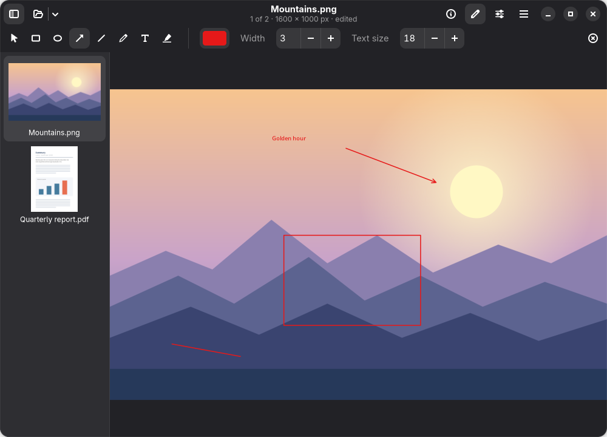
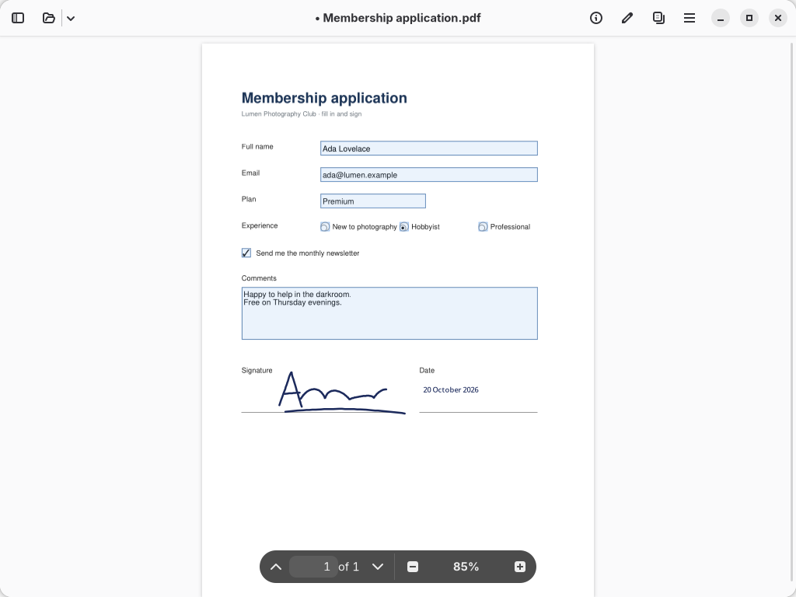
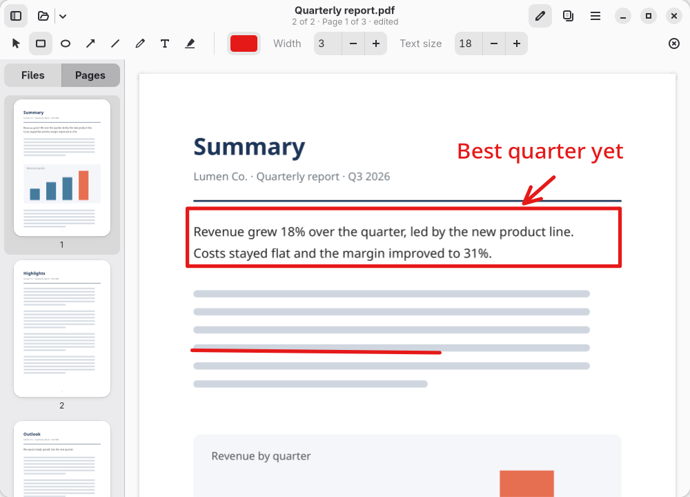
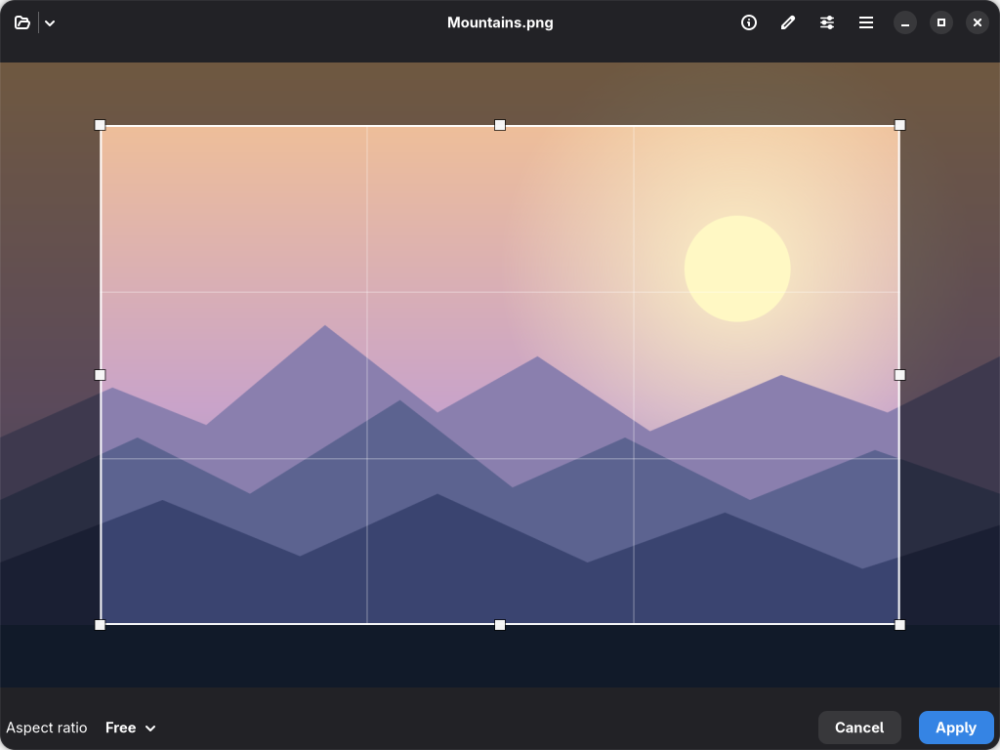

<p align="center">
  
</p>

<h1 align="center">Lumen</h1>

<p align="center">
  A fast image and PDF viewer for Linux, with the light editing, markup, form filling and signing you use every day.<br>
  Written in Rust with GTK 4 and libadwaita.
</p>

<p align="center">
  <a href="https://github.com/ImanolGo/lumen/actions/workflows/ci.yml"></a>
  <a href="LICENSE"></a>
</p>

<p align="center">
  
</p>

## Features

- **Fast.** Pictures and pages load in the background, so the UI never freezes. A 50 MP JPEG is on screen in about half a second and a 500-page PDF opens in about 50 ms (release build, measured on a 2020 laptop).
- **Safe with files from anywhere.** Pictures are decoded by [glycin](https://gitlab.gnome.org/GNOME/glycin), which runs each decoder in its own sandboxed process, so a malicious file cannot reach your system. Editing and saving use the same decoders; Lumen itself only reads a picture's metadata (EXIF, colour profile) in-process. That also brings HEIC, AVIF, JPEG XL, JPEG 2000, OpenEXR and animated GIF, APNG and WebP.
- **Pictures and PDFs in one app.** Open the files you pick, or a whole folder, then drop in more from anywhere and flip through them with thumbnails. Zoom and pan smoothly, honour EXIF orientation, run a slideshow or go fullscreen.
- **Light editing.** Rotate, flip, crop, resize and adjust colour, with undo and redo. Rotating a JPEG does not recompress it.
- **Markup.** Rectangles, ellipses, arrows, lines, pen strokes, text and highlights on pictures and PDFs. PDF annotations are real annotations, so other readers can still edit them.
- **Forms and signatures.** Fill in PDF forms (text, checkboxes, radio buttons, lists) and save them so any reader sees the answers. Draw your signature once and stamp it onto PDFs and pictures, or into a form's signature field.
- **PDF reading.** Continuous scroll, page thumbnails, table of contents, search, text selection and copy, clickable links, password-protected files and document properties.
- **PDF page management.** Rotate, delete, reorder and insert pages, merge files, export pages as a PDF or PNG.
- **Printing** through the native GTK print dialog.
- **Native.** Follows the GNOME HIG and works on any desktop. Preferences, keyboard shortcuts dialog and accessible names are included. Translations use gettext; Spanish ships today.

| Fill in and sign a PDF form | Annotate a PDF | Crop with draggable handles |
|---|---|---|
|  |  |  |

## Installing

The latest release is 0.3.1. Lumen is not on Flathub yet; install it from a release, the AUR or source.

### From a release

Each tagged release on the [releases page](https://github.com/ImanolGo/lumen/releases) has a Flatpak bundle, a `.deb` and an x86_64 tarball.

| Package | Install | Works on |
|---|---|---|
| `lumen.flatpak` | `flatpak install --user lumen.flatpak` | Any distribution with Flatpak (brings its own GNOME 50 runtime) |
| `lumen_X.Y.Z-1_amd64.deb` | `sudo apt install ./lumen_X.Y.Z-1_amd64.deb` | Ubuntu 26.04 or later, Debian testing |
| `lumen-vX.Y.Z-x86_64-linux.tar.gz` | `sudo tar -C / -xzf lumen-vX.Y.Z-x86_64-linux.tar.gz` | Distributions with GTK 4.16+, libadwaita 1.8+, poppler-glib 25.06+ and libseccomp (plus the glycin loaders for sandboxed decoding) |

If your distribution is older than that, use the Flatpak.

### Arch Linux (AUR)

Two packages are maintained in [`build-aux/aur/`](build-aux/aur/): `lumen` builds the latest release and `lumen-git` the latest commit. Once they are on the AUR:

```sh
yay -S lumen        # or lumen-git
```

Or build one straight from this repository:

```sh
cd build-aux/aur/lumen-git && makepkg -si
```

### Debian and Ubuntu, from source

On Ubuntu 26.04+ or Debian testing, `build-aux/debian/build-deb.sh` builds a `.deb` from the source tree (see the script for the packages it needs):

```sh
make deb
sudo apt install ./lumen_*.deb
```

### From source

You need a C toolchain, Rust 1.93 or newer, GTK ≥ 4.16, libadwaita ≥ 1.8, poppler-glib ≥ 25.06, libseccomp, the GLib tools (`glib-compile-resources`) and gettext. At run time, install the glycin loaders for sandboxed decoding (without them Lumen falls back to GTK's own decoders). The build checks these versions.

| Distro | Command |
|---|---|
| Arch / CachyOS | `sudo pacman -S --needed base-devel rust gtk4 libadwaita poppler-glib libseccomp gettext glycin` |
| Fedora | `sudo dnf install gcc cargo gtk4-devel libadwaita-devel poppler-glib-devel libseccomp-devel gettext glycin-loaders` |
| Debian / Ubuntu | `sudo apt install build-essential cargo libgtk-4-dev libadwaita-1-dev libpoppler-glib-dev libseccomp-dev gettext glycin-loaders` |

These are GNOME 49-era libraries, so distributions released before late 2025 (for example Debian 13 and Ubuntu 24.04) are too old; use the Flatpak there. Check what you have with `pkg-config --modversion gtk4 libadwaita-1 poppler-glib`, and use [rustup](https://rustup.rs) if your Rust is older than 1.93.

```sh
git clone https://github.com/ImanolGo/lumen.git
cd lumen
make
sudo make install                    # to /usr
make install PREFIX=$HOME/.local     # or just for your user
```

To try it without installing:

```sh
cargo run --release -- path/to/file.pdf
```

Remove an installed copy with `make uninstall` (use the same `PREFIX`).

## Usage

```sh
lumen                      # empty window, Ctrl+O to open
lumen photo.jpg report.pdf # open files directly
lumen ~/Pictures/Trip      # or every picture and PDF in a folder
```

Drop more files or folders onto the window to add them to the ones you are browsing.

Lumen registers itself for PDF and every picture format the installed glycin loaders read: PNG, JPEG, GIF, WebP, BMP, TIFF, SVG, AVIF, HEIF/HEIC, JPEG XL, JPEG 2000, OpenEXR, QOI, TGA, ICO and the PNM family. Animated GIF, APNG and WebP play. JPEG, PNG, WebP, GIF, BMP and TIFF can also be edited and marked up; edits are saved in place for JPEG, PNG and WebP, and as a copy for the others. Camera RAW files need a glycin RAW loader, which most distributions do not ship yet. To make it the default PDF viewer:

```sh
xdg-mime default io.github.imanolgo.Lumen.desktop application/pdf
```

### Filling in forms

Fields you can fill in have a light blue tint. Click a checkbox or radio button to set it, or a text field or list to type or pick a value next to it. `Enter` finishes a text field; in a field with several lines, `Shift+Enter` starts a new line. Each change can be undone, and `Ctrl+S` saves the answers into the PDF, where any reader sees them. Password-protected PDFs keep their password.

### Signing

Open the markup toolbar (`Ctrl+Shift+A`) and click the signature button. The first time, choose **New Signature…** and sign with your mouse, touchpad or pen; Lumen keeps it for next time. Picking a signature places it on the page, selected, so you can drag it into place and resize it. Clicking a form's signature field signs right into it. In a PDF the signature is a normal ink annotation, so other readers show it. It is a drawn signature, not a certificate-based digital one.

Press `Ctrl+?` in the app for the full, searchable list of shortcuts. The main ones:

| Shortcut | Action |
|---|---|
| `Ctrl+O` | Open |
| `←` / `→` | Previous / next file |
| `Page Up` / `Page Down`, `Ctrl+G` | Previous / next PDF page, go to page |
| `Ctrl+=` / `Ctrl+-`, `Ctrl+0` / `Ctrl+1` | Zoom in / out, best fit / 100 % |
| `Ctrl+R` / `Ctrl+Shift+R` | Rotate right / left |
| `Ctrl+K` | Crop (`Enter` applies, `Esc` cancels) |
| `Ctrl+Shift+A` | Markup toolbar (shapes, text, highlights, signatures) |
| `Enter` / `Shift+Enter` | Finish a text field or note / new line |
| `Ctrl+Z` / `Ctrl+Shift+Z` | Undo / redo |
| `Ctrl+S` / `Ctrl+Shift+S` | Save / Save As |
| `Ctrl+F` | Find in PDF |
| `Ctrl+P` | Print |
| `F9` | Toggle the thumbnail sidebar |
| `F11` / `F5`, `Esc` | Fullscreen / slideshow, leave them |
| `Ctrl+,` | Preferences |

### Files Lumen writes

| Path | Contents |
|---|---|
| `~/.config/lumen/settings.toml` | Preferences |
| `~/.local/share/lumen/state.toml` | Window size, sidebar state, last page per PDF |
| `~/.local/share/lumen/signatures.toml` | Your saved signatures (up to eight), as strokes |

Lumen only overwrites a file you opened when you choose Save. Edits and page changes are kept as working copies until then.

## Contributing

Bug reports and pull requests are welcome. See [CONTRIBUTING.md](CONTRIBUTING.md) for the workflow, and the docs below for how the code is organised.

- [docs/ARCHITECTURE.md](docs/ARCHITECTURE.md): stack, module layout, data flow, coordinate spaces
- [docs/DEVELOPMENT.md](docs/DEVELOPMENT.md): setup, debugging, icons, scripting and screenshots, translations
- [docs/PLAN.md](docs/PLAN.md): the development plan and what is still open
- [docs/RELEASING.md](docs/RELEASING.md): tagging, the AUR and the `.deb`
- [CHANGELOG.md](CHANGELOG.md)

## How Lumen was made

Lumen started because I wanted a fast picture and PDF viewer with light
editing on my own Linux desktop, and nothing quite fit. I'm sharing it in
case it's useful to someone else too.

It was built with an AI coding agent (Claude Code). I chose the features,
directed the work, reviewed the changes and tested the app, but most of the
code, documentation, packaging files and the app icon were generated by the
agent. Commits made this way carry a `Co-Authored-By: Claude` trailer, so the
history shows which ones.

Lumen is provided as is, without warranty of any kind (see sections 15 and 16
of the [GPL](LICENSE)). It has been useful and reliable for me, but please keep
copies of important files before editing or saving over them.

## License

[GPL-3.0-or-later](LICENSE). Lumen links against Poppler, which is GPL-licensed.
