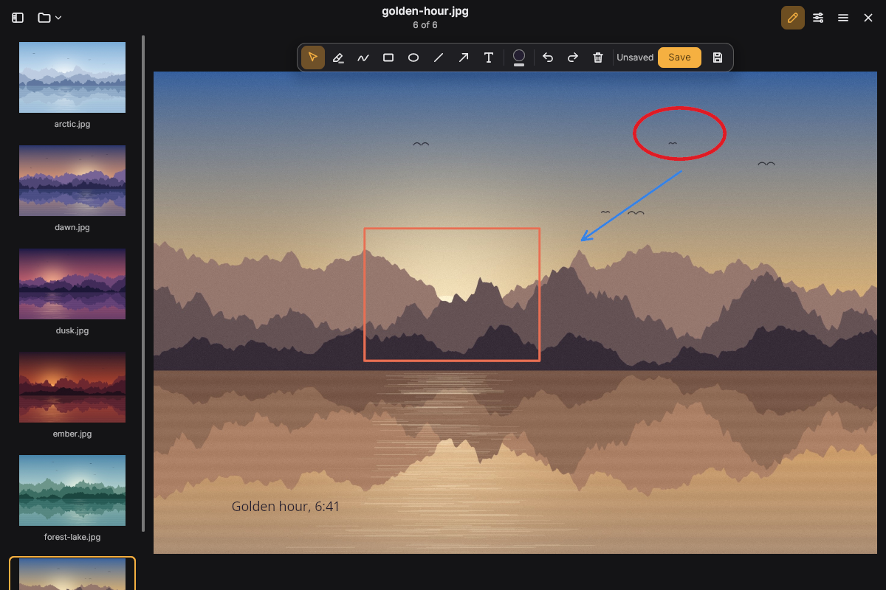
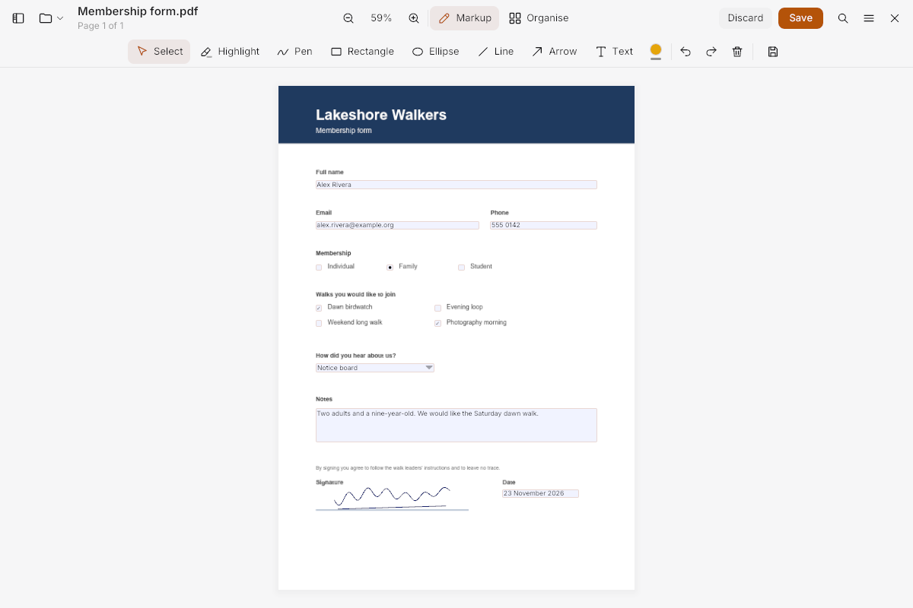
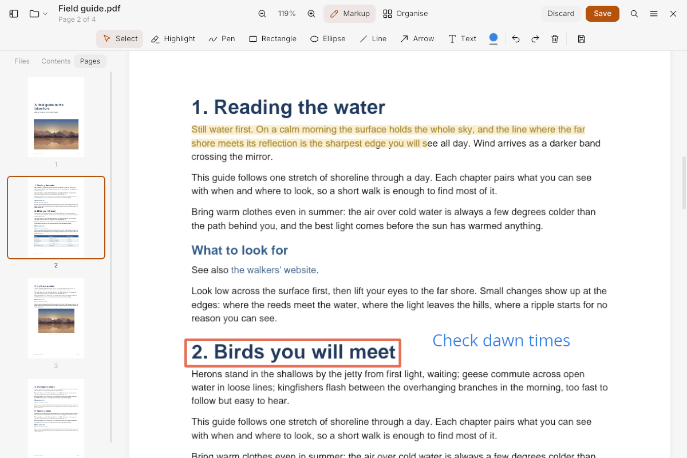
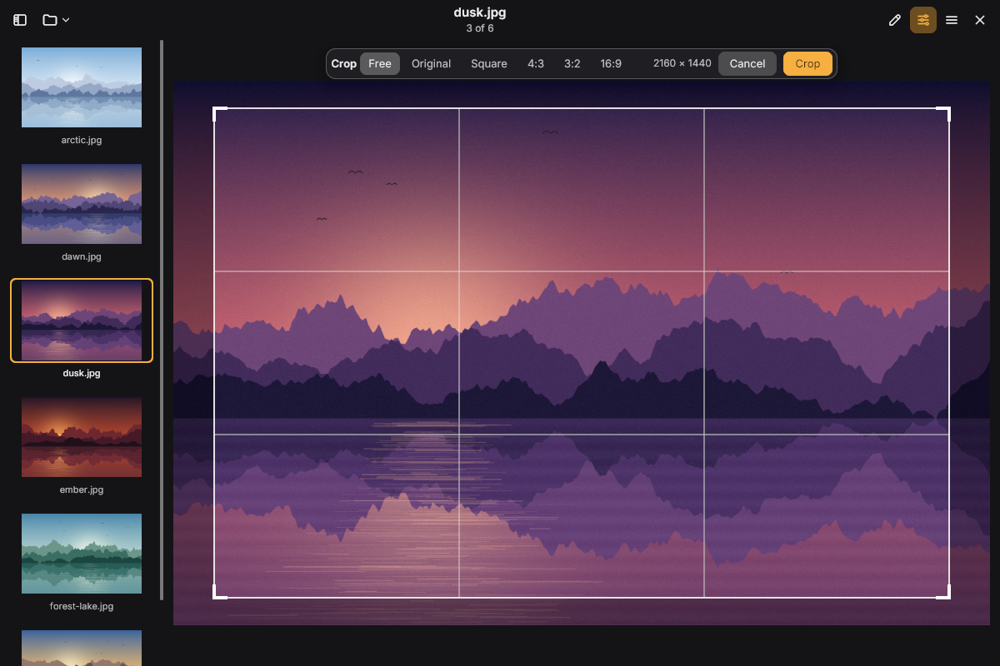
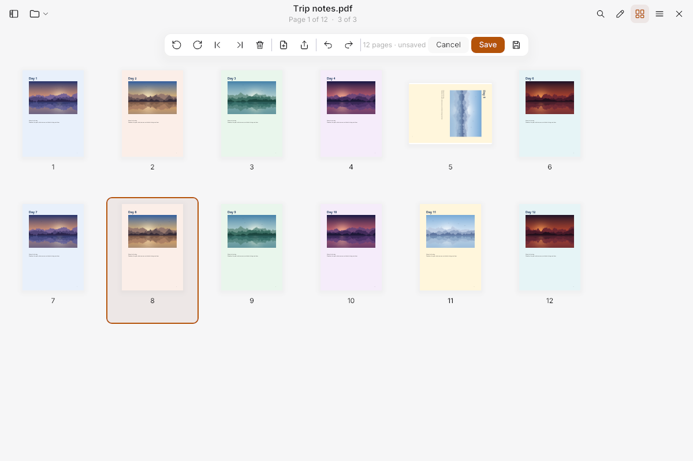
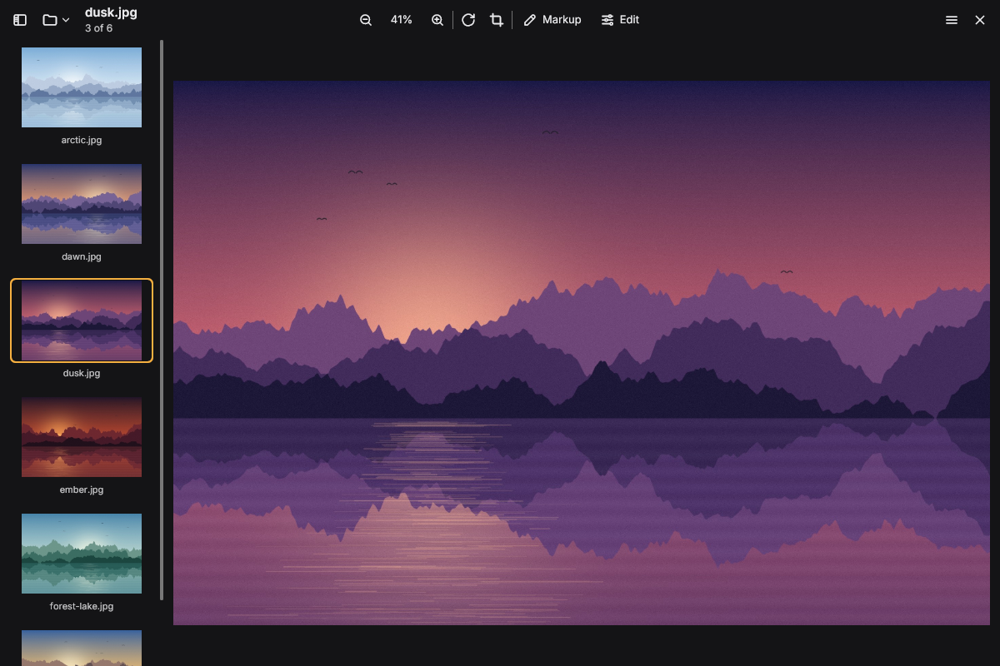
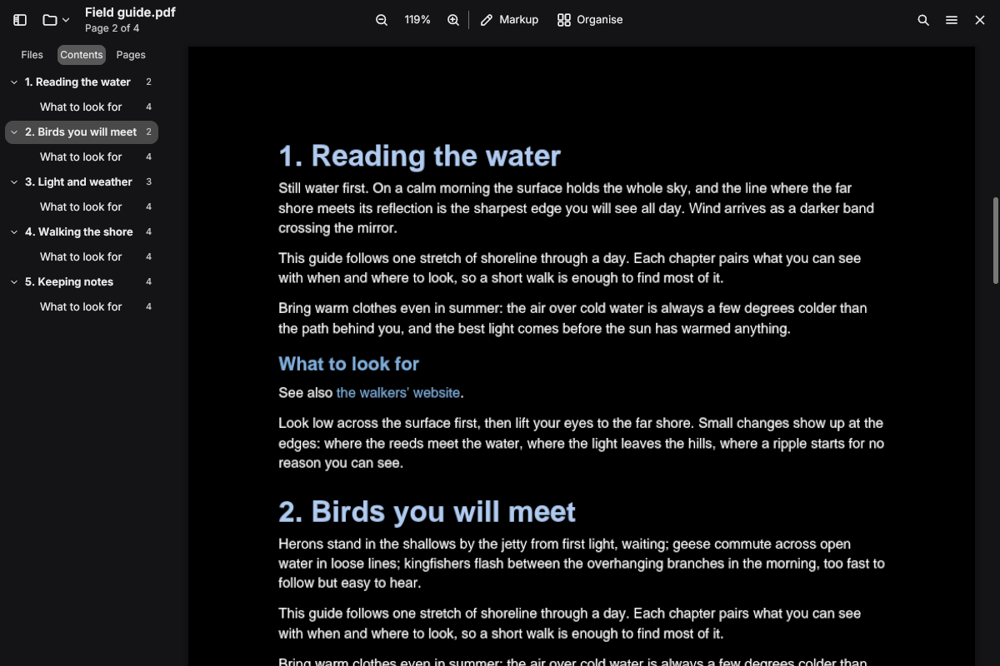

<p align="center">
  
</p>

<h1 align="center">Lumen (Rust/iced)</h1>

<p align="center">
  A fast image and PDF viewer for Linux, macOS and Windows, with the light editing, markup, form filling and signing you use every day.<br>
  Written in pure Rust with <a href="https://iced.rs">iced</a>: no GTK, no poppler, no C in the document path.
</p>

<p align="center">
  <a href="https://github.com/ImanolGo/lumen-rs/actions/workflows/ci.yml"></a>
  <a href="LICENSE"></a>
</p>

<p align="center">
  
</p>

> **Status: early (0.8.0).** This is a ground-up rewrite of [Lumen](https://github.com/ImanolGo/lumen), which is built on GTK 4 and poppler. It has had little use so far; see [docs/STATUS.md](docs/STATUS.md) for what works, what is missing and what has not been checked.

## Features

- **Fast.** Pictures and pages load in the background, so the interface never freezes. A 5120×2160 picture is on screen in about 0.3 to 0.4 s and a 477-page PDF in about 0.2 to 0.4 s, depending on the graphics driver (release build, 2020 laptop; [numbers](docs/STATUS.md#numbers)). Only the pages near the view are rendered, and they re-render sharply at every zoom level.
- **Safe with files from anywhere.** Pictures are decoded in a separate process that shuts itself in with Landlock and seccomp before it reads the file, so a malicious picture cannot reach your system. PDFs are read by [hayro](https://github.com/LaurenzV/hayro) and pictures by pure-Rust decoders, so there is no C code to exploit in between. The app is `#![forbid(unsafe_code)]`.
- **Pictures and PDFs in one app.** Open files or a whole folder, drop in more from anywhere, and flip through them with big thumbnails. Zoom and pan smoothly (pinch on a touchpad too), honour EXIF orientation, run a slideshow or go fullscreen. PNG, JPEG, GIF, WebP, BMP, TIFF, JPEG XL, JPEG 2000, OpenEXR, SVG and more, with animated GIF, APNG and WebP.
- **Light editing.** Turn, mirror, crop, resize, and adjust exposure, contrast and saturation, with undo and redo. Turning a JPEG does not recompress it. Ctrl+S saves JPEG, PNG and WebP in place.
- **Markup.** Highlights, pen, rectangles, ellipses, lines, arrows and text on pictures and PDFs. In a PDF they are real annotations, so every other reader shows them (and the original bytes are kept).
- **Forms and signatures.** Fill in PDF forms (text, check boxes, radio buttons, lists) and save them so any reader sees the answers. Draw your signature once and stamp it onto PDFs and pictures, or into a form's signature field.
- **PDF reading.** Continuous scroll, page thumbnails, table of contents, search, text selection that follows columns, clickable links, password-protected files, document properties, night mode.
- **PDF page management.** Reorder, turn, delete and insert pages, combine files, export pages as PNG or as a new PDF.
- **Printing** through the desktop's print dialog, or straight to CUPS where there is none.
- **Native enough.** Light and dark themes that follow the system, portals for file dialogs, preferences, a keyboard shortcuts dialog, and a Spanish translation.

| Fill in and sign a PDF form | Annotate a PDF | Crop with draggable handles |
|---|---|---|
|  |  |  |

| Organise pages | Browse a folder in the dark | Night mode |
|---|---|---|
|  |  |  |

The full list, with the details, is in [docs/FEATURES.md](docs/FEATURES.md).

## Installing

The [latest release](https://github.com/ImanolGo/lumen-rs/releases/latest) has the packages. The AUR packages and the Flatpak are not published yet; the files to build them are in the repository:

| How | Where | State |
|---|---|---|
| From source | below | works |
| Arch Linux (AUR) | [`build-aux/aur/`](build-aux/aur/): `lumen-rs` (a release) and `lumen-rs-git` (the latest commit). Try one with `makepkg -si` inside its folder | `lumen-rs-git` builds; not on the AUR yet |
| Debian and Ubuntu (`.deb`) | on the release page | works |
| macOS 11 or newer (`.dmg`, Apple silicon and Intel) | on the release page from 0.2 on | new. It is not signed, so macOS says it could not verify it: click Done, then System Settings → Privacy & Security → Open Anyway (or `xattr -dr com.apple.quarantine /Applications/Lumen.app`) |
| Windows 10 or newer (`.zip`, unpack and run `Lumen.exe`) | on the release page from 0.2 on | new. It is not signed: SmartScreen warns; More info → Run anyway |
| Flatpak | [`build-aux/flatpak/`](build-aux/flatpak/) | manifest only, never built |

What works where:

| | Linux | macOS | Windows |
|---|---|---|---|
| Pictures, PDFs, markup, forms, editing, export | yes | yes | yes |
| The picture decoder | a process that is shut in (Landlock, seccomp) | a separate process, **not** shut in | a separate process, **not** shut in |
| File dialogs | the desktop's, or Lumen's own | the system's | the system's |
| Move to trash / undo it | yes / yes | yes / no (Finder can) | yes / yes |
| Open with another program | yes | no | yes |
| Printing | the desktop's dialog, or straight to CUPS | Lumen's dialog, to CUPS | through the program that prints PDFs |
| Copying a picture | Wayland (not GNOME) | yes | yes |

### From source

You need Rust 1.92 or newer ([rustup](https://rustup.rs) if yours is older). Nothing else is needed to build, and nothing but your window system and graphics driver at run time.

```sh
git clone https://github.com/ImanolGo/lumen-rs.git
cd lumen-rs
make                                  # cargo build --release (on Windows, that command)
sudo make install                     # to /usr/local
make install PREFIX=$HOME/.local      # or just for your user
```

To try it without installing:

```sh
cargo run --release -- path/to/file.pdf
```

Remove an installed copy with `make uninstall` (use the same `PREFIX`). AVIF and HEIC need `cargo build --release --features heif` and the `libheif` library; that is the only C code Lumen can reach, so it is off by default.

On the desktop Lumen uses the XDG desktop portal when there is one (`xdg-desktop-portal-gnome`, `-gtk` or `-kde`), so file dialogs, the print dialog and opening links look native. Without one it shows its own file chooser and print dialog (the latter sends jobs straight to CUPS).

## Usage

```sh
lumen-rs                            # empty window, Ctrl+O to open
lumen-rs photo.jpg report.pdf       # open files directly
lumen-rs ~/Pictures/Trip            # or every picture and PDF in a folder
```

Drop more files or folders onto the window to add them to the ones you are browsing. To make it the default PDF viewer:

```sh
xdg-mime default io.github.imanolgo.LumenRs.desktop application/pdf
```

### Filling in forms

Click a check box or radio button to set it, or a text field or list to type or pick a value. `Ctrl+S` saves the answers into the PDF, where any reader sees them. Password-protected PDFs keep their password.

### Signing

Open the signature menu from the markup bar. The first time, draw your signature with the mouse, touchpad or pen; Lumen keeps it for next time. Picking one places it on the page as ink you can drag and resize, and clicking a form's signature field signs right into it. It is a drawn signature, like one on paper, not a certificate-based digital one.

The main shortcuts (☰ → Keyboard Shortcuts has the full list):

| Shortcut | Action |
|---|---|
| `Ctrl+O` / `Ctrl+Shift+O` | Open files / open a folder |
| `←` / `→` | Previous / next file |
| `Page Up` / `Page Down`, `Ctrl+G` | Previous / next PDF page, go to page |
| `+` / `-`, `0` / `1`, `W` | Zoom in / out, best fit / actual size, fit width |
| `R` / `Shift+R` | Turn right / left |
| `E` | Edit the picture (crop, resize, colour) |
| `M` | Markup |
| `G` | Organise the PDF's pages |
| `Ctrl+Z` / `Ctrl+Shift+Z` | Undo / redo |
| `Ctrl+S` / `Ctrl+Shift+S` | Save / save a copy |
| `Ctrl+F` | Find in the PDF |
| `Ctrl+P` | Print |
| `T` | Show or hide the sidebar |
| `F5` / `F11`, `Esc` | Slideshow / fullscreen, leave them |
| `Ctrl+Shift+N` | PDF night mode |

Lumen only overwrites a file you opened when you choose Save. Preferences are in `~/.config/lumen-rs/settings.toml`; the [features page](docs/FEATURES.md#files-lumen-reads-and-writes) lists every file it writes.

## Contributing

Bug reports and pull requests are welcome. See [CONTRIBUTING.md](CONTRIBUTING.md) for the workflow, and the docs for how the code is organised:

- [docs/ARCHITECTURE.md](docs/ARCHITECTURE.md): stack, data flow, module layout
- [docs/DEVELOPMENT.md](docs/DEVELOPMENT.md): running and testing, CI, checking the interface, translations, the control interface
- [docs/FEATURES.md](docs/FEATURES.md): every feature in detail, the keyboard, files and environment variables
- [docs/STATUS.md](docs/STATUS.md): benchmarks, what is missing, what has not been checked
- [docs/FIDELITY.md](docs/FIDELITY.md): how closely PDFs render compared with poppler
- [docs/parity-plan.md](docs/parity-plan.md): the plan for closing the gap with the GTK Lumen
- [docs/RELEASING.md](docs/RELEASING.md): tagging, the AUR, Flatpak
- [CHANGELOG.md](CHANGELOG.md)

## How Lumen was made

Lumen started because I wanted a fast picture and PDF viewer with light editing on my own Linux desktop, and nothing quite fit. This edition is a rewrite of it in pure Rust, to see how fast and how safe it could be without GTK or poppler. I'm sharing it in case it's useful to someone else too.

It was built with an AI coding agent (Claude Code). I chose the features, directed the work and tested the app, but most of the code, documentation, packaging files and the app icon were generated by the agent. Commits made this way carry a `Co-Authored-By: Claude` trailer, so the history shows which ones.

Lumen is provided as is, without warranty of any kind (see sections 15 and 16 of the [GPL](LICENSE)). It is a first release that has not had much use: please keep copies of important files before editing or saving over them.

## License

[GPL-3.0-or-later](LICENSE), like the original Lumen. The bundled Inter font is under the SIL Open Font License (`assets/fonts/OFL.txt`).
