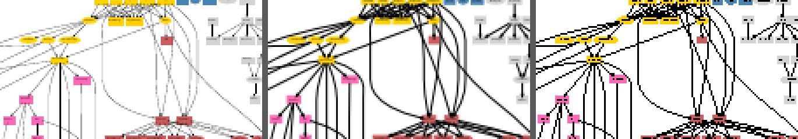
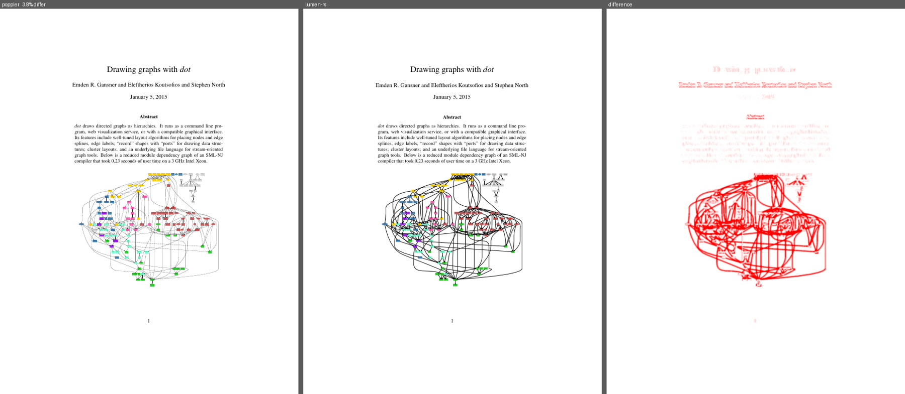
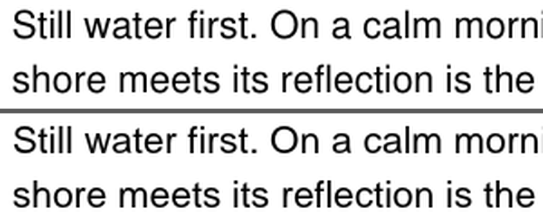
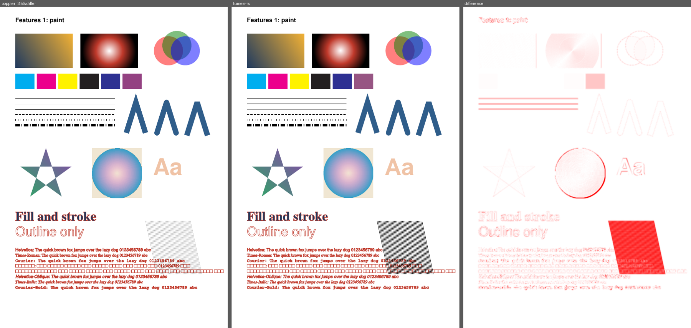

# PDF rendering fidelity

How closely lumen-rs (which draws PDFs with [hayro](https://github.com/LaurenzV/hayro)) matches
poppler, the reference most Linux readers use. Measured on 24 November 2026 with hayro 0.9 and poppler's
`pdftoppm`.

## Result

hayro and poppler agree closely. No page in the corpus was drawn wrongly: nothing missing, misplaced,
mis-coloured by more than a shade, or failing to open. The differences are small and come from three
places, none of them ours to fix (see [What differs](#what-differs)).

| | 72 dpi | 144 dpi |
|---|---|---|
| Real documents (30 PDFs, 132 pages) | median page: 0.33% of pixels differ; none over 5% | median 0.50%; none over 5% |
| Feature test (`features.pdf`, 3 pages) | median 0.11%; worst page 3.5% | median 0.51%; worst page 1.3% |
| Pages that failed to open or render | 0 | 0 |
| Time to draw one page (median / slowest) | 10 ms / 57 ms | 14 ms / 67 ms |

A pixel counts as different when, after a one-pixel blur (so ordinary anti-aliasing does not count),
its colour differs from poppler's by more than 40 of 255. Percentages therefore measure visible
disagreement, not exact equality; a perfect match is unreachable between two renderers.

## What was compared

- **Real documents:** every PDF on the author's machine that was not private, up to four per producer so no tool dominates, six pages each (the first two, the last and three in between): LaTeX manuals (pdfTeX), LibreOffice, OpenOffice, Microsoft Word, Skia, cairo and Ghostscript output, CUPS test pages, the Ghostscript manuals (42 and 477 pages), and the test fixtures.
- **A feature test** (`tools/make_feature_pdf.py`): linear and radial gradients, overlapping transparency, clipping to a star, CMYK colours, dash patterns, line caps and joins, an image with an alpha channel, text drawn as fill and stroke or outline only, the standard fonts, an embedded TrueType font with accents, Greek and Cyrillic, rotated and squashed text, tables of thin rules, and a page marked `/Rotate 90`.

Everything that was checked looked right: gradients, transparency, clipping, image alpha, dashes, caps and
joins, text modes and the rotated page all match poppler. Symbol and ZapfDingbats (not installed on the
machine) show as boxes in both.

## What differs

### 1. Hairlines are heavier (hayro's one-pixel minimum)

Lines thinner than a pixel are drawn at least one device pixel wide in hayro
(`set_stroke_properties` in `hayro/src/path.rs`: "ensure a line width of at least 1.0, as required by the
PDF specification"). poppler draws them thinner and fainter. It shows on graph drawings and fine tables at low
resolution, and is the largest difference found: the worst real page, `dotguide.pdf` page 1, differs in 3.8% of
its pixels at 72 dpi and 2.2% at 144 dpi, almost all of it the graph's edges.



Left to right: poppler, lumen-rs, Ghostscript. Ghostscript also draws one-pixel lines, so hayro is
following the specification's wording; poppler is the lighter one. Lumen draws at the window's scale,
so on a normal or HiDPI screen the effect is smaller than in the 72 dpi numbers.



### 2. Text is very slightly heavier

Glyph shapes and positions match, but hayro's anti-aliased text looks a touch bolder than poppler's
(top: poppler, bottom: lumen-rs, enlarged three times). This accounts for most of the 0.3 to 0.5% of
pixels that differ on ordinary text pages, and grows with resolution because there are more edge pixels.



### 3. Smaller things

- **CMYK colours** convert slightly differently (a mid CMYK mixture was a few shades off; pure cyan, magenta, yellow and black matched closely).
- **Page size in pixels** differs by one pixel on pages whose size is not a whole number of points (hayro's is one pixel smaller in each direction than poppler's). Content lines up exactly at the far corner, so this is a one-pixel sliver, and Lumen scales each page's bitmap to its size in points anyway.
- **Zero-width lines** (a width of 0, meaning "thinnest possible") are drawn like poppler's and lighter than Ghostscript's.



## What was done about it

Nothing in Lumen needed changing: every difference above is how hayro draws, and the interface already
renders at the screen's scale. These are the things that could be raised with hayro, not yet reported
anywhere (filing them is the maintainer's call):

1. A way to turn off, or lower, the one-pixel minimum line width for strokes, for readers that prefer poppler's fainter hairlines. Today it is a constant.
2. The pixmap size for pages that are not a whole number of points: it is one pixel smaller than poppler's.
3. The CMYK to RGB conversion, if a closer match to poppler's is wanted.

## Repeating it

```sh
python3 tools/fidelity.py OUT_DIR /usr/share/doc tests/fixtures --dpi 72
python3 tools/make_feature_pdf.py features.pdf && python3 tools/fidelity.py OUT_DIR features.pdf --dpi 144
```

`tools/fidelity.py` needs poppler-utils, numpy and Pillow. It draws the pages with `pdftoppm` and with
the ignored test `render_corpus` in `src/pdf.rs` (`cargo test --release render_corpus -- --ignored`),
writes `OUT_DIR/report.md` (every page, worst first) and `OUT_DIR/worst/` (poppler | lumen-rs |
difference). A third opinion from Ghostscript (`gs -sDEVICE=png16m`) is useful when the two disagree.

## Limits

- The corpus is mostly text documents from LaTeX and office tools, plus one synthetic feature test. It has no scanned documents, no PDFs full of JPEG 2000 or JBIG2 images, no CJK fonts (the CJK font on the machine could not be embedded), and few PDFs with soft masks, blend modes or patterns.
- The pdf.js test corpus was not used (it would have meant downloading hundreds of untrusted files).
- Pixel difference after a blur is a proxy for "looks the same"; it cannot say which renderer is right, which is why the worst pages were looked at.
